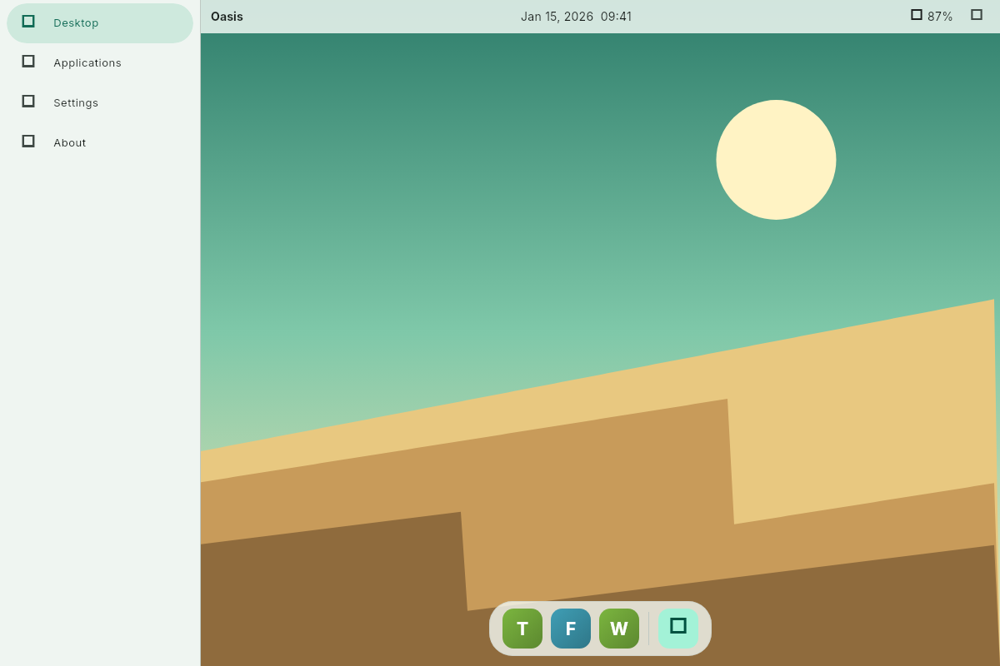
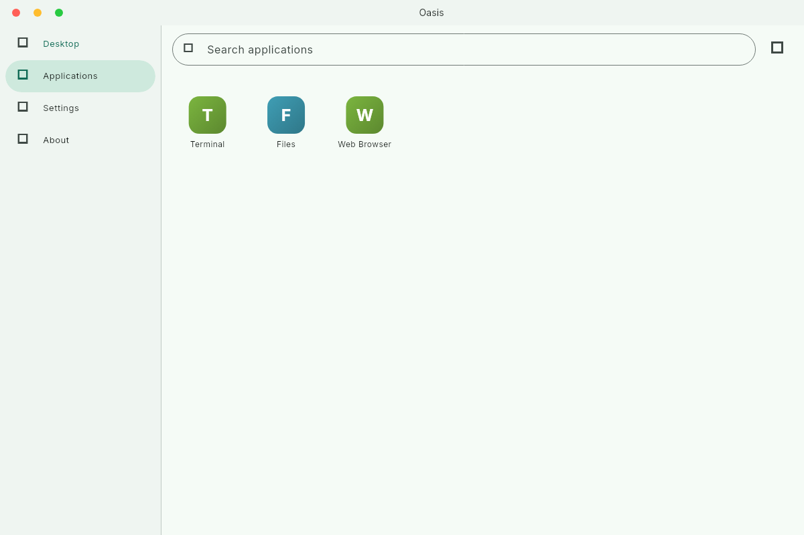
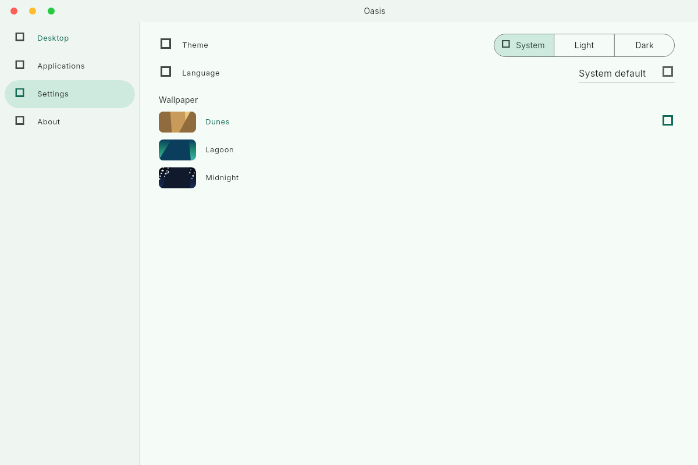

# Oasis

[](https://gitlab.com/HttpAnimations/oasis/-/pipelines)
[](https://gitlab.com/HttpAnimations/oasis/-/releases)
[](LICENSE)
[](https://httpanimations.gitlab.io/oasis/)

A desktop environment shell for Wayland, built with Flutter. Oasis gives your
Linux machine a fast, beautiful desktop: a live panel, a real application
launcher that reads your installed apps, session controls, and a settings
experience that feels at home.

**[Landing page](https://httpanimations.gitlab.io/oasis/)** ·
**[Try the web build](https://httpanimations.gitlab.io/oasis/app/)** ·
**[Releases](https://gitlab.com/HttpAnimations/oasis/-/releases)**





## Features

- Painted wallpapers, no image assets needed
- Launcher that reads real .desktop files
- Panel with clock, battery and quick settings
- Session actions: lock, suspend, restart, power off
- macOS-style window chrome with drag and double-click maximise
- Light and dark themes, Traditional English, 简体中文, Русский, Gaeilge
- In-app update checks against GitLab releases

## Install

Flatpak (x86_64 and aarch64):

```
curl -fLO https://httpanimations.gitlab.io/oasis/flatpak/key.gpg
flatpak remote-add --if-not-exists --gpg-import=key.gpg oasis https://httpanimations.gitlab.io/oasis/flatpak
flatpak install oasis gitlab.httpanimations.oasis
```

Or one line with the flatpakref:

```
flatpak install https://httpanimations.gitlab.io/oasis/oasis.flatpakref
```

Binaries for every release are on the
[releases page](https://gitlab.com/HttpAnimations/oasis/-/releases): AppImage,
`.deb`, `.rpm`, and plain archives.

## Development

- `flutter test` runs the suite; coverage stays at 100%
- `flutter test --update-goldens` regenerates screenshots
- `flutter run -d linux` runs the shell
- `landing/` is the landing page (Flutter web); `flutter build web` there
